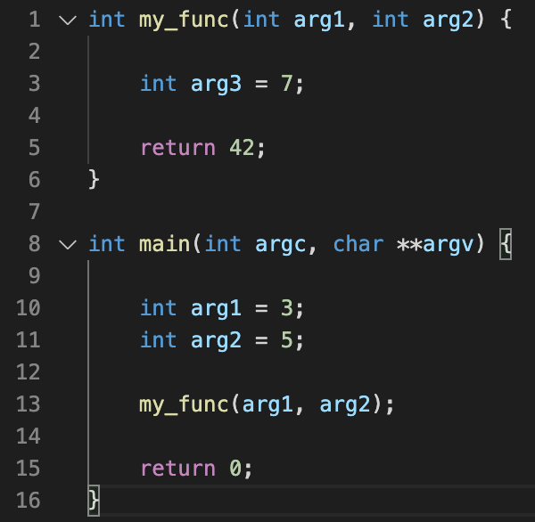
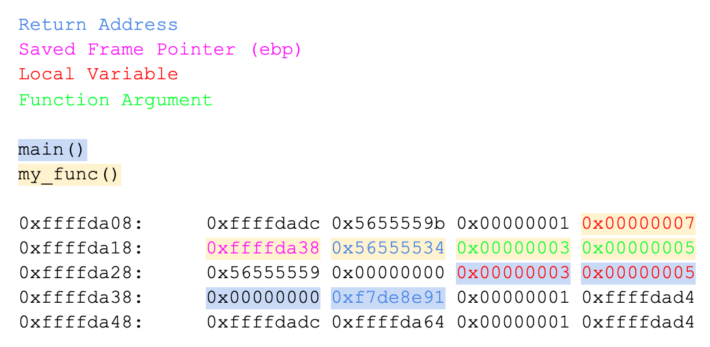

import UsedIn from "../../../components/UsedIn.jsx";

# Homework: Introduction to gdb

<UsedIn>[Fall 2018](/fall2018) to [Winter 2020](/winter2020), [Winter 2022](/winter2022) to [Winter 2023](/winter2023) (as Homework 10); [Fall 2020](/fall2020) to [Fall 2021](/fall2021) (as Homework 9)</UsedIn>

This homework is intended to introduce you to the `gdb` debugger,
understand how to examine and update memory locations `gdb`, and gain
experience with how the runtime stack is organized.

In addition to the lecture material, you can watch this [introductory
video on buffer overflow
attacks](https://www.youtube.com/watch?v=RF7DF4kfs1E).

The file
[examine_stack.c](http://faculty.cs.byu.edu/~seamons/examine_stack.c)
makes a series of function calls main → freshman → sophomore → junior
→ senior. Compile the program and run it in the debugger, breaking
somewhere in function senior. Print out all of the stack activation
frames, and label as many memory locations as you can.

Not all the stack locations will be labeled. Extra space may be
allocated on the stack that is set to uninitialized values that
already existing in memory. Be sure to label the following elements
for all four functions. You should be able to identify

1. return addresses
1. saved frame pointers (ebp)
1. local variables
1. function arguments

For example, if you had a function that looked like this:

  

Then you might label things like this:

  

Use the “info frame” gdb command to compare the information you
labeled with what the debugger reports is in each stack frame. You may
print out a hard copy, write on it to label all the items, and turn in
a scan of the hard copy. You may also create your result
electronically. Make it easy for the TAs to grade.

Compile the program with the -m32 compiler option. We will use a
32-bit program for simplicity. You should also compile with -g to give
debugging info.

## Useful GDB Debugger Commands

See [this cheat sheat](https://darkdust.net/files/GDB%20Cheat%20Sheet.pdf).

> // start debugger from the command line

> gdb [executable name]

> // list source code, hit [enter] to list more

> (gdb) list 1

> // set break point at line 10

> (gdb) break 10

> // start running program, enter parameters

> (gdb) run [parameters]

> // execute the next line of code and pause

> (gdb) step

> // display values of registers or variables

> (gdb) print \$esp

> // examine a block (32 words) of memory in hex

> (gdb) x /32xw [address]

> // change the value of a memory address pointer

> (gdb) set *(int *)[addr] = [val]

> // see the assembly code stored in memory

> (gdb) disassemble main

## Submission

Submit a PDF via Learning Suite.

## Earlier versions

- Fall 2018 to Winter 2020 didn't have the two example images.
