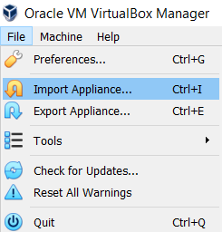
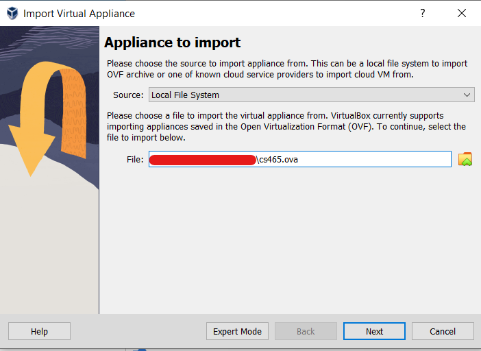
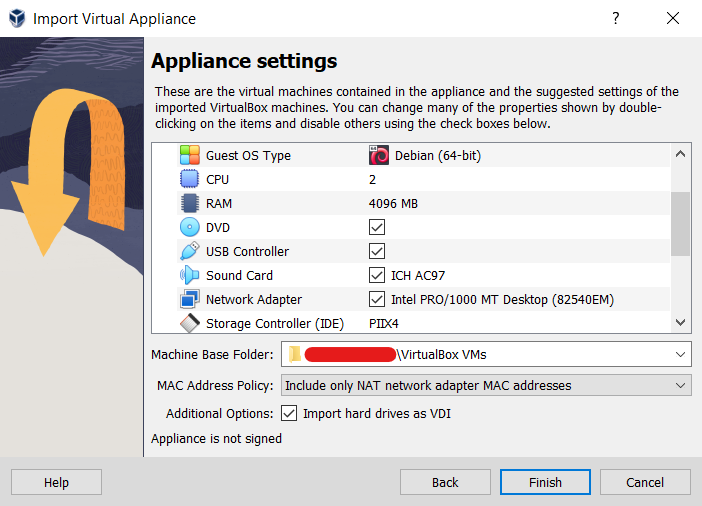
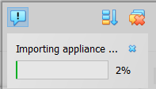
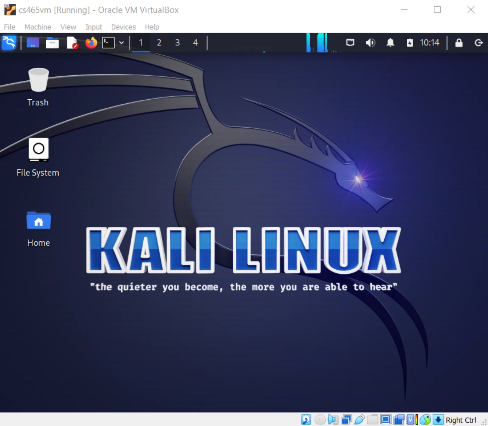
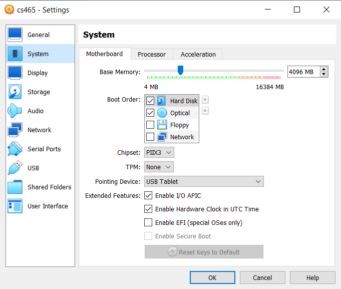

import UsedIn from "../../../components/UsedIn.jsx";

# Project: Virtual Machine Setup

<UsedIn>[Fall 2023](/fall2023) (as an extra page)</UsedIn>

(if you don't want to use the lab machines, see "Setup on your own Computer" below)

If you don't have VirtualBox installed on your personal computer (or just don't want to), you can use the CS lab machines. They all have VirtualBox installed on them, so getting your VM up and running shouldn't take very long.

## Video Demonstration

A video demonstrating setting up the virtual machine for labs 7 8 and 9 is [here](https://youtu.be/h2PAhhFUquY)

## Step 1: Get the VM into your home directory
First, log in to a lab machine. You can do this by sshing into `<netid>@moat.cs.byu.edu` or by physically going to the Talmage building.

While in your home directory (or wherever you want to save it), run the following command to copy the VM to your current directory:
```
cp /users/groups/cs465ta/kali_vm_2023/cs465vm.ova ./
```

The file is about 3.5 GB in size, so it might take a minute or 2.

## Step 2: Import the VM into VirtualBox

For this step, you'll want to actually go to the lab machines. Most of them are located in the Talmage basement.

First, open the `File` menu and select `Import Appliance...` 



Next, select the Kali VM (should be a `.ova` file). Click `Next`.



You should be brought to this window showing a bunch of options. You can keep all of these as they are and click `Finish`. 



VirtualBox will now begin importing the Kali VM. You should be able to see the progress on the right side of the window.



Once it finishes importing, just select the VM from the list and click `Start`. Here are the login details:

```
Username: student
Password: cs465-student
```

Your desktop should look like this:


All project files are located in `~/465-projects`.

## Common Pitfalls

You only have 25 GB of storage reserved for your CS account. This VM takes up about 10 GB of space, so if you don't have enough storage, you will encounter errors. Make sure you have enough space during every step of the process.

When deleting files to clear up space, don't forget to empty the `Trash`.

---

## Setup On your Own Computer

Kali Linux is a common operating system for beginners in cyber security. It comes pre-packaged with tools for things such as network mapping, password cracking, and reverse-engineering.

You have been provided with a Kali Linux Virtual Machine (VM) to use for the following projects:
* Password Cracking
* Extracting Secrets
* Buffer Overflow  

The purpose of this page is to help you install/setup/use the Kali VM.

## Video Demonstration

A video demonstrating setting up the virtual machine for labs 7 8 and 9 is [here](https://youtu.be/h2PAhhFUquY)

## Installation

To install the VM, you will need a virtual machine manager. I recommend VirtualBox, which can be downloaded [here](https://www.virtualbox.org/wiki/Downloads). VirtualBox is also installed on all the CS lab machines, so feel free to use those for each project.

The VM image can be downloaded [here](https://students.cs.byu.edu/~cs465ta/cs465vm.ova).

### Importing into VirtualBox

First, open the `File` menu and select `Import Appliance...` 


Next, select the Kali VM you downloaded (should be a `.ova` file). Click `Next`.


You should be brought to this window showing a bunch of options. You can keep all of these as they are and click `Finish`. 


VirtualBox will now begin importing the Kali VM. You should be able to see the progress on the right side of the window.


Once it finishes importing, just select the VM from the list and click `Start`. Here are the login details:

```
Username: student
Password: cs465-student
```

### Important Files

All the necessary project files can be found in the `465-new-projects` folder (located in your home directory). Inside, there should be 2 folders, `buffer_overflow` and `extracting_secrets`. All the file you will need for these projects will be in their respective folders.

### Important Tools

Here is a list of the tools you will need for these projects and how to access/use them:

1. GNU Debugger (GDB)

   GDB is a debugging tool used for code examination and runtime manipulation. You will use GDB for the Extracting Secrets project and the Buffer Overflow project. 

   To run a C executable with GDB, simply type the following into the command line:

   ```
   gdb <name of C executable>
   ```

   You can find a more detailed GDB tutorial [here](/crypto-course/projects/gdb-tutorial).

2. John the Ripper and Hashcat
   
   John the Ripper and Hashcat are both tools you will use for the Password Cracking project. They are useful for cracking hashes and creating custom wordlists.

   You can find a tutorial for using John the Ripper and Hashcat [here](/crypto-course/projects/john-hashcat-tutorial).

### Other Notes

To allocate more memory for your VM, just select it in VirtualBox and go to `Settings/System`. You can then drag the memory slider or type in how much memory you want the VM to use. 



**You cannot change these settings while the VM is running.**
